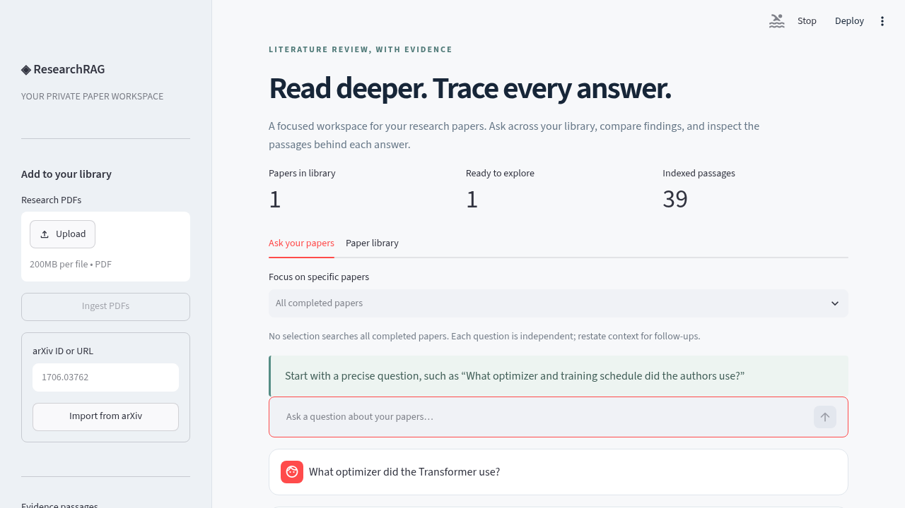
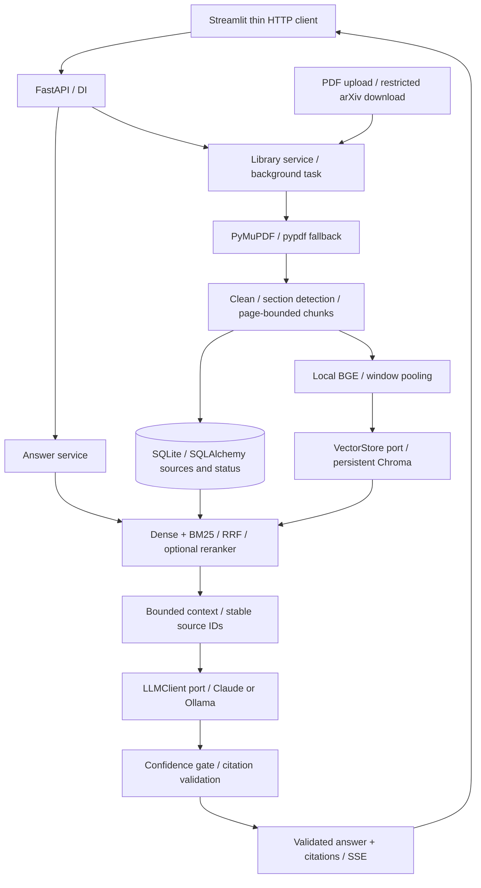

# ◈ ResearchRAG

**Read deeper. Trace every answer.** A local-first research PDF assistant with FastAPI,
Streamlit, hybrid retrieval, stable citations, and inspectable source passages.

Upload PDFs or import arXiv IDs, select papers, and ask questions. Answers include
`[Paper Title, p.4, Methods]` and the exact extracted passage behind each citation.
All document storage, embeddings and retrieval are local. Claude is the default provider;
Ollama is an explicitly selected, free local alternative. No paid service is required.



## Quick start — five commands

Prerequisites: Python 3.11+ (verified on 3.13), Make, and [Ollama](https://ollama.com)
installed and running. For a practical experience use **8 GB+ RAM**; 3B models may need more
with long contexts. Initial embedding/model downloads require internet access.

```bash
python -m venv .venv && . .venv/bin/activate
pip install torch==2.6.0 --index-url https://download.pytorch.org/whl/cpu && pip install -e '.[dev]'
cp .env.example .env
ollama pull llama3.2:3b
RESEARCHRAG_LLM_PROVIDER=ollama make -j2 run-api run-ui
```

The CPU PyTorch command is for Linux/Windows; on macOS use `pip install -e '.[dev]'`
without the extra index command. The initial unconstrained PyTorch download failed in
this sandbox; the CPU build worked. No changes to the requested stack were needed.

Open **http://localhost:8501**. API docs: **http://localhost:8000/docs**.
The UI calls FastAPI server-to-server, not from browser JavaScript.

For Claude, set `RESEARCHRAG_ANTHROPIC_API_KEY` in `.env`, verify the model name available
to your account, and omit the provider override above. The app uses the Messages API
through HTTP, with no Anthropic SDK requirement. It never silently switches to a paid provider.

For low-RAM development, `qwen2.5:0.5b` fits but is **not recommended for research answers**:
it frequently refuses or selects irrelevant text. A staged demo with the better 1.5B model
works on ~2 GB without concurrently holding embedding and LLM weights:

```bash
ollama pull qwen2.5:1.5b
OMP_NUM_THREADS=2 RESEARCHRAG_LLM_PROVIDER=ollama \
  RESEARCHRAG_OLLAMA_MODEL=qwen2.5:1.5b RESEARCHRAG_OLLAMA_BATCH_SIZE=16 \
  RESEARCHRAG_OLLAMA_CONTEXT_SIZE=4096 python eval/demo.py --low-memory
```

Stop a running API first on such constrained hosts. The normal API does not use this staged
optimization; it keeps the embedder resident. See [verification](docs/verification.md)
and the [real two-paper demo with exact snippets](docs/demo.md).

## Usage

1. Upload one or more text-based PDFs, or enter `1706.03762` / an arxiv.org abs/pdf URL.
2. Open **Paper library**, refresh until `done`, and inspect failures if present.
3. Select specific papers in chat, or leave selection empty to search all completed papers.
4. Ask a precise question. Expand each citation to inspect the original extracted text.
5. Export the conversation and evidence to Markdown. Use re-ingest to retry failures or
   rebuild after changing extraction or embedding settings. Confirm deletion explicitly in the UI.

Questions are independent. Chat history is UI-only; it is not sent as hidden context.
Multi-paper questions are supported through selection, but there is no specialized comparison
pipeline, automatic summary, or query rewriting.

### API examples

```bash
curl -F 'file=@paper.pdf;type=application/pdf' http://localhost:8000/api/papers
curl -H 'Content-Type: application/json' -d '{"arxiv":"1810.04805"}' http://localhost:8000/api/papers/arxiv
curl http://localhost:8000/api/papers
curl -H 'Content-Type: application/json' -d '{"question":"Which optimizer was used?","top_k":4}' http://localhost:8000/api/query
curl -N -H 'Content-Type: application/json' -d '{"question":"Which optimizer was used?"}' http://localhost:8000/api/query/stream
```

- `GET /api/health` is liveness, not a model-readiness check.
- `GET /api/papers/{id}` reports `pending | processing | done | failed`.
- `POST /api/papers/{id}/reingest`; `DELETE /api/papers/{id}`.
- `paper_ids: null` searches all completed papers; `paper_ids: []` searches none.
- Upload/import return HTTP 202; duplicates return the existing paper without re-indexing.
- SSE events are `status`, `token`, `done`, or `error`. `done` contains the full Answer schema.
  Consume `done` before persisting a successful streamed response.
- Domain input errors are 400, missing records 404, busy jobs 409, model errors 503,
  schema errors 422. Errors after SSE headers become `error` events, not HTTP status changes.
- `python -m researchrag.cli 'Which optimizer was used?'` queries the same persisted library.

## Architecture



```
src/researchrag/
  api/          routers, schemas, dependency graph, application factory
  core/         domain objects, exceptions, JSON logging
  db/           SQLite schema and short-lived-session repository
  ingestion/    PDF/arXiv loading, normalization, sectioning, chunking, library lifecycle
  embeddings/   Embedder protocol and local sentence-transformers adapter
  retrieval/    VectorStore protocol, Chroma, BM25, RRF, optional cross encoder
  llm/          provider-neutral streaming port, Claude and Ollama HTTP adapters
  rag/          context building, confidence gating, citations and answer service
ui/app.py       Streamlit; no database, embedding, or RAG imports
tests/          unit and offline integration tests, synthetic fixture PDF
eval/           12 gold-phrase Q&A cases over Transformer and BERT, runner, demo
```

### Correctness and design decisions

- **SQLite is the authoritative source of truth.** Only `done` paper chunks can be retrieved.
  Vector insertion happens before the SQLite completion transaction. Partial jobs cannot expose
  unfinished source data. Failed vector writes are cleaned up best-effort; orphan vectors remain
  invisible because every retrieval is joined against searchable SQLite IDs.
- **One API process / one worker.** Ingestion is serialized within a process, with short library
  mutation locks. BackgroundTasks is not a durable queue. Startup marks interrupted jobs failed
  for explicit retry; it never incorrectly reports them as complete. Do not run multiple workers
  against this local data directory. CLI/eval writers also require exclusive use of it.
- **Deduplication:** SHA-256 of exact bytes, including arXiv imports. Upload paths use UUIDs;
  original filenames are sanitized metadata only. Limits default to 25 MB and 500 pages.
- **PDF provenance:** common two-column layouts are read column-wise; repeated margins and
  wrap hyphens are cleaned, Unicode ligatures normalized, common/numbered headings detected.
  Sections carry across pages. Chunks never cross page/section boundaries, so citations always
  refer to a single physical PDF page (1-based, not printed page labels).
- **Chunk sizes:** approximate 600 tokens with 80-token overlap, capped at a section/page boundary;
  short fragments are intentional. The BGE model's 512-token limit is handled by overlapping
  tokenizer windows and normalized mean pooling, not silent truncation of the whole chunk.
- **Stable IDs:** source labels are `S_` plus a deterministic chunk hash over document ID,
  page, section, position, and text. They persist across identical re-ingestion, not across a
  delete/re-upload that creates a new paper ID. Changed parser output appropriately changes IDs.
- **Model-specific Chroma collections** avoid mixed dimensions. Re-ingest every paper after an
  embedding-model change; SQLite alone cannot indicate which model collection is populated.
- **Hybrid search:** cosine dense candidates + BM25 ranks fused with RRF (`k=60`). BM25 is rebuilt
  from the selected completed chunks per query: simple and consistent, but not for large corpora.
  The optional cross encoder reranks candidates only; it is off by default.
- **Confidence:** a configurable raw dense-similarity threshold, never RRF score, gates LLM use.
  This is a heuristic, not a calibrated probability. Tune against your own evaluation corpus.
- **Citations fail closed:** unknown/missing IDs or uncited sentences withhold the completion.
  Every accepted ID maps to the exact retrieved title, page, section and snippet. This checks
  provenance and sentence coverage, **not semantic entailment** for Claude's generated prose.
- **Ollama is conservative/extractive:** JSON grammar constrains available IDs; each generated
  excerpt must appear verbatim in its cited passage (whitespace normalized), or the answer is
  refused. Source-internal square brackets become parentheses in answer text to distinguish
  bibliography markers from ResearchRAG citations; the source snippet stays unchanged.
  A real failed tiny-model paraphrase motivated this check. Excerpts can still be irrelevant.
- **Streaming safety over first-token speed:** providers stream internally, but the service buffers
  and validates the complete answer before streaming public text and final citation mapping.
  The endpoint is not unchecked token-by-token model streaming. A `status` event arrives first.
- **Privacy:** no source bodies or credentials are intentionally logged. PDFs are sent to Claude
  only when that provider is selected; Ollama remains local. Models must be cached for offline use.

## Configuration

Copy `.env.example`. Pydantic validates `RESEARCHRAG_*` variables; environment values override `.env`.
Important settings include `DATA_DIR`, `EMBEDDING_MODEL`, `LLM_PROVIDER`, `ANTHROPIC_API_KEY`,
`ANTHROPIC_MODEL`, `OLLAMA_URL`, `OLLAMA_MODEL`, `TOP_K`, `MIN_DENSE_SCORE`, `RERANK`,
`MAX_UPLOAD_MB`, `MAX_PAGES`, `CHUNK_TOKENS`, `OVERLAP_TOKENS`, `CONTEXT_CHARS`,
`OLLAMA_CONTEXT_SIZE`, and `OLLAMA_BATCH_SIZE`, each with the prefix above.
`RESEARCHRAG_API_URL` configures the Streamlit server's HTTP target (environment, not `.env` loading).

For offline operation after caching models, use `HF_HUB_OFFLINE=1` and
`TRANSFORMERS_OFFLINE=1`, select Ollama, and upload PDFs instead of importing arXiv.
The first model download can take time; ingestion status remains `processing`.
Keep context character budget comfortably below the LLM's actual token context minus output budget;
character estimates are not an exact tokenizer check. On CPU, `OMP_NUM_THREADS=2` can help avoid oversubscription.

## Verification and evaluation

```bash
make lint types test
make eval                        # requires the two benchmark papers already ingested
python eval/run.py --ingest       # downloads/ingests them if missing
python eval/run.py --answers      # also calls configured LLM; may incur Claude charges
python eval/demo.py               # full-service two-paper, three-question live demo
```

The checked-in evaluation obtained **11/12 retrieval hits at k=6** using gold phrase proxies.
See `eval/results.json` and `docs/verification.md` for actual run details and limitations.
`--answers` reports provenance validity and answer coverage separately: all-refusal runs do **not**
receive a misleading 100% citation score (`null` when there are no citations).
This tiny evaluation is not a scientific accuracy benchmark. Refusals and unsupported claims
must be reviewed alongside retrieval hit rate. The checked-in live demo's three citations were
verified against stored source text; its correct answers required a better model than the 0.5B model.

Tests use deterministic fake embeddings and a fake LLM with real PDF extraction, SQLite,
persistent Chroma and HTTP endpoints. Unit tests cover configuration, headings/chunks,
column reading order, RRF, citations, confidence gates, provider protocols, extraction rejection,
and restart recovery. No network or API keys are needed for tests. Ruff and strict mypy cover
production source, UI and eval scripts. See the seven milestone git commits.

## Docker

```bash
cp .env.example .env  # configure Claude, or select Ollama in this file
make docker-up
```

Compose persists sources and Chroma in `researchrag-data` and model downloads in `model-cache`.
Both exposed ports bind to loopback. Host Ollama is reached via `host.docker.internal`; on Linux
it must accept connections from the Docker bridge (set `OLLAMA_HOST=0.0.0.0:11434` on the host
and restrict access with your firewall). Docker itself was unavailable in the build sandbox:
configuration was parsed, but no image build or container runtime was verified.

## Limitations / next steps

- Local single-user tool: no authentication, tenancy, encryption at rest, rate limits, or durable queue.
  Do not expose it publicly as-is. Add a reverse-proxy request-body limit: application size checks
  happen after multipart parsing/spooling. Treat PDF parsing as untrusted and isolate it in production.
- No OCR. Fully scanned PDFs fail clearly; mixed scanned/text pages are not OCRed and may be absent.
  Tables, equations, footnotes, complex layouts, and inferred headings can extract imperfectly.
- Grounding is not guaranteed by a valid citation. Claude prose needs entailment evaluation;
  local extractive answers need relevance evaluation. Prompt injection inside papers remains a risk.
- Thresholds are heuristic, and answer coverage depends heavily on local model quality. Tiny models
  can quote irrelevant evidence or refuse answerable questions. This is explicitly observed, not hidden.
- No token-level safe low-latency streaming, resumable ingestion, multi-worker coordination,
  cached BM25 index, schema migrations, automatic summaries, query rewriting, or server-side memory.
- Prioritize semantic answer evaluation, a durable worker queue, parser/OCR isolation, migrations,
  auth, and reproducible dependency locking before adding more features.
